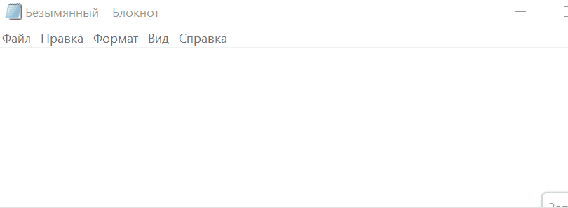

# SuperDictate 🎤


Локальная, полностью офлайн-диктовка для **Windows и Linux**, работающая на базе передовой русскоязычной модели **GigaAM v3** от Сбера. Приложение работает в фоне, не отправляет ваши голосовые данные в облако и активируется по горячей клавише (по умолчанию **F9**).

> **Форк проекта [shlgd/SuperDictate](https://github.com/shlgd/SuperDictate)** (оригинальная версия для macOS), портированный на Windows и Linux с использованием ONNX Runtime и GigaAM.

---

## 📸 Как это выглядит в работе

<!-- Если гифка тяжелая, можно добавить width="800" -->


*Просто зажмите `F9`, скажите фразу и отпустите — текст мгновенно появится в активном окне.*

---

## ✨ Особенности

- **100% Офлайн**: аудио обрабатывается локально, никакие данные не уходят в сеть.
- **Высокая точность**: модель GigaAM v3 (RNN-T) отлично работает на русском языке, расставляет знаки препинания и заглавные буквы.
- **Удобный интерфейс**: иконка в системном трее с меню настроек, переключателем звука и **динамической статистикой**.
- **Выбор микрофона**: возможность выбрать конкретное устройство ввода в настройках.
- **Умная вставка**: анализ контекста вокруг курсора для автоматической расстановки пробелов и заглавных букв.
- **Кроссплатформенность**: единая кодовая база для Windows и Linux (X11 и Wayland).
- **Логирование**: все ошибки записываются в файл `superdictate.log` (доступен из меню трея).

---

## 📦 Установка

### Windows

1. Скачайте `SuperDictate-Windows.zip` со страницы [Releases](../../releases/latest).
2. Распакуйте архив в любую папку (например, `C:\Program Files\SuperDictate\`).
3. Запустите `SuperDictate.exe`.
4. При первом запуске модель GigaAM (~850 МБ) скачается автоматически.

> ⚠️ Не запускайте `.exe` изнутри zip-архива. Обязательно распакуйте его!

> **Важно:** Может потребоваться установленный Microsoft Visual C++ Redistributable (x64).

<details>
<summary>🛡️ Если Windows Defender ругается на программу (ложное срабатывание)</summary>

Поскольку `.exe` собирается с помощью PyInstaller и не имеет цифровой подписи, антивирусы часто ошибочно реагируют на него.

**Решение:** Добавьте папку с программой в исключения. Запустите PowerShell от имени администратора и выполните:

```powershell
Add-MpPreference -ExclusionPath "C:\Путь\К\Папке\SuperDictate"
```

Если файл уже удалён, восстановите его через **«Защитник Windows»** → **«Журнал защиты»**.

</details>

<details>
<summary>🛠️ Установка из исходников (для разработчиков)</summary>

```powershell
git clone https://github.com/Biggant13/SuperDictateWin.git
cd SuperDictateWin
python -m venv venv
.\venv\Scripts\Activate.ps1
pip install -r requirements-dev.txt
python main.py
```

</details>

### Linux

Программа поддерживает **X11** и **Wayland**. В Wayland используется бэкенд `evdev` (требуется группа `input`).

#### Автоматическая установка (рекомендуется)

Скрипт скачает программу, создаст ярлык в меню и настроит права.

```bash
curl -sL https://raw.githubusercontent.com/Biggant13/SuperDictateWin/main/install_superdictate.sh | bash
```

> Скрипт запросит пароль `sudo`. После установки нужно выйти из системы и зайти снова.

<details>
<summary>🐧 Ручная установка (если скрипт не подходит)</summary>

1. Скачайте `SuperDictate-Linux.tar.gz` со страницы [Releases](../../releases/latest).

2. Установите зависимости:

   **Ubuntu / Debian:**

   ```bash
   sudo apt install python3-tk libportaudio2 xclip libayatana-appindicator3-1
   ```

   **Fedora:**

   ```bash
   sudo dnf install python3-tkinter portaudio xclip libayatana-appindicator-gtk3
   ```

   **Arch:**

   ```bash
   sudo pacman -S tk portaudio xclip libayatana-appindicator
   ```

3. Распакуйте и запустите:

   ```bash
   tar -xzf SuperDictate-Linux.tar.gz
   cd SuperDictate
   ./SuperDictate
   ```

</details>

<details>
<summary>🛠️ Установка из исходников (для разработчиков)</summary>

```bash
git clone https://github.com/Biggant13/SuperDictateWin.git
cd SuperDictateWin
python3 -m venv .venv
source .venv/bin/activate
pip install -r requirements-dev.txt
python main.py
```

</details>

---

## 🚀 Первый запуск и настройка

- Приложение свернётся в трей.
- Зажмите `F9`, говорите, отпустите — текст вставится в активное окно.
- Клик по иконке в трее → **Настройки** (можно сменить хоткей, микрофон и т.д.).

### Файлы конфигурации

- `config.json` — настройки (создаётся автоматически).
- `stats.json` — статистика распознанных слов.
- `superdictate.log` — файл логов для отладки.
- `gigaam-v3-e2e-rnnt-onnx/` — папка со скачанной моделью (~850 МБ).

---

## ⚠️ Известные ограничения

- **Linux / GNOME**: appindicator может быть скрыт по умолчанию (требуется расширение AppIndicator).
- **Первый запуск**: требуется интернет для скачивания модели (~850 МБ). Дальше приложение работает офлайн.

---

## 🧠 Технологии

[GigaAM v3](https://github.com/salute-developers/GigaAM) | [onnx-asr](https://github.com/istupakov/onnx-asr) | [sounddevice](https://github.com/spatialaudio/python-sounddevice) | [pynput](https://github.com/moses-palmer/pynput) | [pystray](https://github.com/moses-palmer/pystray).

---

## 📜 История изменений

Полная история версий доступна в файле [CHANGELOG.md](CHANGELOG.md).

**Последние изменения (v1.5.1):**

- Добавлена поддержка Wayland (Linux) через `evdev`.
- Добавлен скрипт автоматической установки для Linux.
- Добавлено логирование в файл `superdictate.log` и кнопка «Открыть лог» в трее.

---
